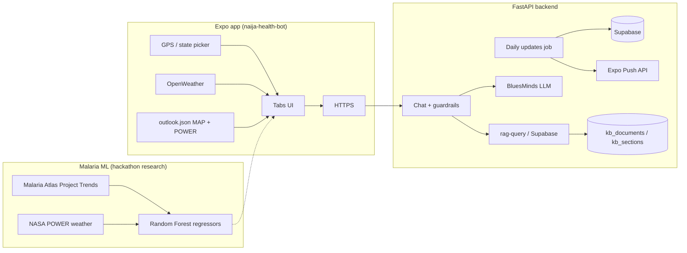

# 9ja Health

**AI-powered malaria awareness and health intelligence for Nigeria — mobile-first, source-grounded, and built for everyday use.**

9ja Health helps people understand malaria risk in context, take practical prevention steps, and get **trustworthy answers** from a curated knowledge base — without replacing doctors or guessing personal diagnoses.

**Origins.** The product grew from the **Veritas AI International High School Hackathon (Health track)** — team **Neuraxis** (Olumide-Olaiya Samuel, Coker Oluwatoniloba). The mobile app and backend extend that work into a deployable stack; the malaria **forecasting research** below is the scientific foundation for **Prevention** (Outlook uses the same datasets as trends only).

---

## Why this matters

Malaria still kills more than **600,000 people per year** worldwide, mostly in sub-Saharan Africa. Nigeria carries one of the largest burdens of disease on the continent — across **all 36 states and the FCT**. At the same time:

- **Communities** need clear, sourced guidance; **planners and clinics** need foresight into incidence trends to allocate nets, treatment stock, and campaigns.
- **Misinformation spreads faster than clinics can respond.** People search symptoms online, buy the wrong medicines, or delay testing.
- **Transmission follows weather, history, and place**, but most apps either show raw forecasts or generic articles — not a joined-up, area-level story.
- **Official guidance exists** (WHO, NMEP, NCDC) but is scattered across PDFs, portals, and news sites that few people read end-to-end.

9ja Health is aimed at that gap: **actionable, honest information** for people living in Nigeria, with strict safety boundaries and named sources — the same need that global health programmes emphasise for digital health in LMICs, applied to one high-impact disease first.

---

## The problem → our response

| Problem | What 9ja Health does |
|--------|----------------------|
| People need malaria facts they can trust, not model hallucinations | **Retrieval-augmented assistant (RAG)** over a curated knowledge base (WHO and allied sources), loaded into Supabase; answers are blocked if nothing relevant is retrieved |
| Chatbots often diagnose, dose, or wander off-topic | **Server-side guardrails**: malaria-only scope, no dosing, medicine names limited to retrieved text; off-topic and unsafe prompts refused |
| “Risk” apps imply personal predictions | **Area-level framing only** — population patterns and environment, never “you have malaria” |
| Weather affects mosquitoes but users do not see the link | **Live local weather** on Home via **OpenWeather**; Outlook rainfall from **NASA POWER** yearly series |
| Planners / users lack simple incidence foresight | **Outlook** = dataset trends (MAP + NASA POWER). **Prevention** = trained model likelihood + tips when the prediction API is wired |
| Health news is noisy | **Updates** feed: allowlisted scrape → AI write-up → Supabase → `GET /api/v1/health-reports`; optional **Expo push** when new rows publish |
| Secrets and keys must not live in the app | **FastAPI backend** holds LLM and Supabase service keys; the Expo app only calls `EXPO_PUBLIC_*` values |

---

## Current product status (as of this README)

Bottom tabs: **Home · Outlook · Prevention · Assistant · Updates**. **Profile** (and optional **Account**) open from the Home avatar.

| Screen | What works today | Needs config / still open |
|--------|------------------|---------------------------|
| **Home** | GPS → Nigerian state, live OpenWeather strip (temp, feels-like, humidity, rain, wind, cloud cover), outlook teaser, prevention & updates shortcuts, assistant entry | `EXPO_PUBLIC_OPENWEATHER_API_KEY`; location permission or manual state |
| **Outlook** | State/FCT **incidence line chart** (MAP) vs Nigeria average, **rainfall bars** (NASA POWER), insight cards, honest “not personal risk” copy | Bundled `src/data/outlook.json` (rebuild via `npm run build:outlook-data`) |
| **Prevention** | Home for the **trained malaria model**: likelihood, category, period, factors, and tips | Weather context shown; model report still placeholder until the Prevention API is live |
| **Assistant** | Live chat to FastAPI; RAG + guardrails; guests OK; signed-in users save history | `EXPO_PUBLIC_API_BASE_URL` + BluesMinds + Supabase RAG |
| **Updates** | Pull-to-refresh feed of published AI write-ups + official authority directory | Backend + Supabase `health_reports`; optional push tokens SQL |
| **Profile** | Location, larger text, notifications (push + in-app reminder), privacy/about, explore removed | Push needs physical device + `push_tokens.sql` |
| **Account** | Optional Supabase email/password + TOTP | `EXPO_PUBLIC_SUPABASE_*` + backend Supabase keys |

**Safety (non-negotiable):** not a diagnostic tool; emergencies → **112** in Nigeria; no prescriptions or dosing; medical copy should be reviewed before wide release.

---

## Architecture



**Knowledge base:** Markdown sections under `backend/knowledge_base/RAGInfo/documents/`, loaded with `python -m scripts.load_knowledge`. SQL and edge functions: `backend/supabase/README.md`.

---

## Features in detail

This section explains **each major feature** as it exists in the repo, including the technical path end-to-end.

### 1. Location → Nigerian state

**User-facing.** On launch (and on refresh), the app asks for **foreground** location only. If granted, Home shows the resolved state (e.g. “Lagos”) and wires weather + Outlook to that area. If denied, outside Nigeria, or unresolved, the UI offers a **manual picker** of all 36 states + FCT.

**Technical path.**

1. `expo-location` → `requestForegroundPermissionsAsync` / `getCurrentPositionAsync` (`Accuracy.Balanced`) in `src/services/locationService.ts`.
2. Coordinates are reverse-geocoded with **BigDataCloud**’s free client endpoint (`reverse-geocode-client`) — no API key.
3. Response `principalSubdivision` (and fallbacks) is matched against the canonical list in `src/constants/nigeriaStates.ts` (`matchNigerianState`).
4. Country code must be `NG`; otherwise `LocationServiceError` with code `outside_nigeria`.
5. Manual picks use **state-capital centroids** from the same constants file so weather still has a lat/lon.
6. State is held in `EnvironmentProvider` (`src/hooks/useEnvironment.tsx`): location is shown **before** weather finishes so the UI never looks blank while OpenWeather loads.

**Privacy note.** Only foreground GPS; no background tracking. Preference copy lives under Profile → Privacy.

---

### 2. Live weather (OpenWeather)

**User-facing.** Home **Weather strip** shows temperature, feels-like, humidity, rainfall, wind, cloud cover, a short summary, source label, and last-updated time. Refresh re-requests GPS + weather. Prevention and Outlook also read the same snapshot when present.

**Technical path.**

1. Key: `EXPO_PUBLIC_OPENWEATHER_API_KEY` in `naija-health-bot/.env` (baked into the JS bundle — fine for a free demo key; production should proxy).
2. `fetchCurrentWeather` in `src/services/weatherService.ts` calls  
   `GET https://api.openweathermap.org/data/2.5/weather?lat=&lon=&appid=&units=metric`.
3. Client uses a **hard Promise.race timeout** (~12s) plus `AbortController` so a hung network cannot spin forever (earlier Open-Meteo attempts hung on some Nigerian networks).
4. Mapping: `main.temp` / `feels_like` / `humidity`, `wind.speed` (m/s → km/h × 3.6), `rain.1h` or `rain.3h`, `clouds.all`, `weather[0].description`, `dt` → ISO.
5. HTTP **401** / **429** surface clear messages (bad key / rate limit). Missing key fails fast with setup instructions.
6. UI: `WeatherStrip`, `OutlookCard` teaser; status machine in `useEnvironment`: `loading` | `ready` | `needs_manual` | `weather_error` | `error`.

---

### 3. Outlook (area trends + rainfall)

**User-facing.** For the selected state/FCT: insight chips (latest incidence, 5-year change, vs Nigeria), a **line chart** of estimated cases per 1,000 people (area vs national average), and a **bar chart** of yearly rainfall. Copy repeatedly states this is **not personal risk**.

**Technical path.**

1. Data is **bundled** at build/dev time in `src/data/outlook.json` (MAP incidence + NASA POWER climate + national average series). Regenerated by:

   ```sh
   cd naija-health-bot
   npm run build:outlook-data   # runs scripts/build-outlook-data.py over nasa_power_yearly/ CSVs
   ```

2. `getOutlookForState` / `computeInsights` / `climateForIncidenceYears` in `src/services/outlookData.ts` select the state slice and derive peak year, 5-year % change, and vs-national delta.
3. Charts are custom **react-native-svg** components (`IncidenceTrendChart`, `RainfallTrendChart`):
   - Width from **`onLayout`** (not screen width guesses) so bars/lines stay inside the card.
   - X-axis labels are **thinned** by pixel budget so years do not mash together.
   - Incidence Y-axis uses **nice ticks**; rainfall highlights wettest/latest years in meta text.
4. Research Random Forest models (below) are **not yet** a live prediction API; Outlook today is **historical / observational** visualisation of the same data families used in the hackathon study.

---

### 4. Prevention (trained model home)

**User-facing.** This tab is where **all trained-model outputs** appear: incidence/likelihood, category, period, factors, and tips from the rules engine. Weather context is shown when available. Until the Prevention API is live, the report card says **Report not ready yet** and the static tip checklist remains as interim guidance.

**Technical path.**

1. UI shell: `src/app/prevention.tsx` (slots for every model field).
2. Interim tips: `preventionGroups` in `src/constants/healthContent.ts` + session checklist in `usePrototype`.
3. Future: `POST /api/v1/prevention` returns model estimate + rule-based tips; Outlook does **not** consume ML inference.

---

### 5. Assistant (RAG chat + guardrails)

**User-facing.** Chat tab with starter prompts, streaming-style busy state, source links on answers, emergency copy when triggered, optional sign-in to save conversations.

**Technical path (request lifecycle).**

```text
App askAssistant()
  → POST /api/v1/chat  { messages[], conversation_id? }  + optional Bearer JWT
  → backend services/chat_service.answer()
       1. Sanitise transcript (roles, length, history cap)
       2. Input guardrails (emergency / self-harm / injection / “live weather|news|outlook” → app referral)
       3. Topic / pleasantry checks
       4. RAG retrieve (Supabase edge rag-query, cosine threshold + top-k)
       5. If no passages → fixed “no knowledge” reply (no free-form LLM inventing malaria facts)
       6. BluesMinds chat completion with system prompt + passages + source id rules
       7. Output guardrails: scope (malaria vs other vs app), dosage ban, medicine allow-list from retrieved text
       8. Strip unapproved URLs; attach approved Source objects
       9. Optional history write if authenticated
  ← { response, model, guardrail, urgent, sources, conversation_id, saved }
```

**Key modules.**

| Piece | Location |
|-------|----------|
| Mobile client | `src/services/assistantApi.ts` |
| Pipeline | `backend/services/chat_service.py` |
| Input guardrails | `backend/guardrails/scope.py` (+ topic / medicines / output) |
| Retrieval | `backend/services/retrieval.py` → Supabase `rag-query` |
| LLM | `backend/ai/bluesminds.py` — primary model + ordered fallbacks |
| Rate limits | Per-IP anon + tighter limits for authed history routes |
| System prompt | `backend/prompts/system_prompt.md` (cached) |

**Auth.** Guests chat freely. With Supabase configured, email/password + **TOTP** (`src/app/account.tsx`, `useAuth`). Access token is sent only for chat/history; **service_role never ships in the app**.

---

### 6. Updates (daily official briefings)

**User-facing.** Updates tab loads up to **5** published write-ups (title, AI summary, topic, date, link to original). Pull-to-refresh. Below: directory of NCDC / FMOH / NPHCDA-style authorities.

**Technical path.**

1. **Ingest job** `POST /api/v1/jobs/daily-health-updates` with header `X-Job-Secret` (`UPDATES_JOB_SECRET`), or in-process scheduler ~**07:00 Africa/Lagos** when enabled on Render (`UPDATES_SCHEDULER_ENABLED` / `RENDER_EXTERNAL_URL`).
2. Pipeline (`backend/services/reports_pipeline.py`):
   - Load active rows from `update_sources` (priority-ordered allowlist).
   - Scrape feeds/pages (`reports_scraper`).
   - Dedupe by `url_hash`.
   - Prefer Nigeria-first sources (NCDC, FMOHSW, NPHCDA, NMEP, then WHO).
   - AI summarise each new article (`reports_summarizer`) into title/summary/topic/urgency/location_scope.
   - Insert `health_reports` with `is_published=true`.
   - If `items_inserted > 0`, call **Expo Push** notify (`push_notify.py`).
3. App: `GET /api/v1/health-reports?limit=` via `src/services/healthReportsApi.ts` → `src/app/updates.tsx`.
4. SQL: `backend/supabase/health_reports.sql`.

---

### 7. Push notifications (new health updates)

**User-facing.** Profile → Notifications → **New health updates**. Opt-in requests OS permission; tapping a notification opens the Updates tab.

**Technical path.**

1. Mobile: `expo-notifications` + `expo-device`; token via `getExpoPushTokenAsync` (`src/services/pushNotifications.ts`). Preference persisted in AsyncStorage.
2. `POST /api/v1/push-tokens` `{ token, platform, enabled }` upserts `device_push_tokens` (service_role only; RLS denies anon). SQL: `backend/supabase/push_tokens.sql`.
3. On publish, backend batches Expo Push API (`https://exp.host/--/api/v2/push/send`) with `data.screen = "updates"`. Stale `DeviceNotRegistered` tokens are soft-disabled.
4. Requires a **physical device** (simulators/web are limited). Restart Expo after enabling the notifications plugin in `app.json`.

---

### 8. Accounts & conversation history

**User-facing.** Optional account for saving chats; list/open/delete conversations from Profile.

**Technical path.**

1. Supabase Auth in the app (`src/services/supabase.ts` — anon key only).
2. Backend verifies JWT and uses the user’s token (or service patterns documented in `auth/`) for row-level access to history tables (`chat_history.sql`).
3. Routes: `GET/DELETE /api/v1/conversations`, `GET /api/v1/conversations/{id}` (`backend/api/conversations.py`, `services/history.py`).
4. Chat may attach `conversation_id` so turns append to the same thread when `saved: true`.

---

### 9. Design system & shell

**User-facing.** Light-only cream/green brand (`#7DBA84` / `#F5ECD4` / `#232323`), Inter, shared buttons/cards/sheets.

**Technical path.** Tokens in `src/constants/designTokens.ts`; primitives in `src/components/healthUi.tsx`; icons via `expo-symbols` (`healthIcon.tsx`). Tab shell: `app-tabs.tsx` / `appShell.tsx`. Product/design briefs: `prompts-and-guides/`.

---

### 10. Backend platform concerns

| Concern | Implementation |
|---------|----------------|
| Config | `backend/config.py` + `.env` (never commit secrets) |
| CORS | `ALLOWED_ORIGINS` includes Expo web ports 8081–8083 |
| Keep-alive | Self-ping `/api/v1/health` on Render so free tier does not sleep |
| Health | `GET /api/v1/health` reports provider, model, `configured`, `accounts`, `rag` |
| Docs | OpenAPI at `/docs` |

---

## Malaria modelling (Prevention research)

This section summarises the **Neuraxis** prototype documented in the hackathon submission (`Naija Health Bot` PDF / Colab notebook). It is **not** a validated public-health forecasting system yet. All trained-model outputs are meant for the **Prevention** screen (via a Prevention API). **Outlook** only visualises the underlying MAP + POWER yearly series as observational trends — it does not run ML inference.

**Question.** Can we estimate **annual clinical *Plasmodium falciparum* incidence** (cases per **1,000** population) for Nigeria’s **37 administrative areas** (36 states + FCT) by combining **environment** with **historical malaria**?

**Data.**

| Source | Role |
|--------|------|
| [MAP Trends](https://malariaatlas.org/) | **962** state-level incidence records, **2000–2025** |
| [NASA POWER](https://power.larc.nasa.gov/) | Daily temperature, rainfall, humidity, wind — aggregated to **annual** values per state, paired with the **following year’s** incidence |

**Models (scikit-learn Random Forest).**

- **Model 1:** state identity + previous-year weather.
- **Model 2:** Model 1 + **previous-year incidence** in the same state.

**Evaluation (chronological, no leakage):** train **2001–2015**, validate **2016–2020**, hold-out test **2021–2025**. Compared with an **average** baseline and a **previous-year** baseline (MAE, RMSE, R²).

**Hold-out test results (2021–2025):**

| Approach | MAE | RMSE | R² |
|----------|-----|------|-----|
| Average baseline | 99.756 | 110.416 | −1.708 |
| Previous-year baseline | **19.245** | **25.442** | **0.856** |
| Model 1: state + weather | 79.815 | 98.085 | −1.137 |
| Model 2: state + weather + prior incidence | 20.725 | 26.863 | 0.840 |

**What we learned.** Prior-year incidence is highly informative; adding it to a forest model nears the simple **previous-year baseline** but **does not beat it** on the final test set. With this setup, **annual weather features alone did not show a clear extra edge** over history — an important honest result for product copy and for the next modelling iteration.

**Known limits (stated in the submission).**

- **State/FCT resolution only** — no LGA, neighbourhood, or outbreak hotspots.
- **One climate point per state**; **annual** averages hide **seasonal** transmission patterns.
- No covariates yet for **ITN coverage**, **case management**, spraying, or healthcare access.
- **Not** individual risk; **not** for diagnosis or treatment decisions.

**Modelling roadmap (from the submission).**

- Monthly / **LGA-level** surveillance where available.
- **Seasonal** rainfall and temperature features, not yearly means only.
- Public-health intervention data as features.
- Stronger **time-series** and other algorithms; broader validation before operational use.

The **live app** uses **OpenWeather** for “weather now”; Outlook uses **bundled MAP + POWER history**; Prevention awaits the Prevention prediction API (likelihood, category, factors, and rule-based tips).

---

## Repository layout

```text
naija-health-bot/          React Native + Expo Router mobile app (SDK 58)
  src/app/                 Screens (tabs + profile / account)
  src/services/            Weather, location, assistant, reports, push, outlook data
  src/components/          Shared UI, weather strip, location picker, outlook charts
  src/data/outlook.json    Bundled MAP + NASA POWER series for Outlook
  src/hooks/               Auth, environment, prototype session, update push
  scripts/                 build-outlook-data.py
backend/                   FastAPI service (e.g. Render)
  api/                     chat, health, conversations, health-reports, jobs, push-tokens
  guardrails/              Input/output safety
  services/                RAG, chat, reports pipeline, push notify, scheduler, keep-alive
  knowledge_base/          Approved sources + RAG document corpus
  supabase/                SQL (chat, rag, health_reports, push_tokens) + edge functions
  scripts/                 load_knowledge, run_daily_updates, refresh_feed_writeups
prompts-and-guides/        Product, design, checklist, engineering reference
```

---

## Quick start

### Mobile app

Requirements: Node.js compatible with **Expo SDK 58**, npm.

```sh
cd naija-health-bot
npm ci
cp .env.example .env    # set keys below
npx expo start          # Expo Go on device, or press w for web
```

| Variable | Purpose |
|----------|---------|
| `EXPO_PUBLIC_API_BASE_URL` | Backend root, e.g. `http://127.0.0.1:8000` or your Render URL |
| `EXPO_PUBLIC_OPENWEATHER_API_KEY` | Current weather on Home |
| `EXPO_PUBLIC_SUPABASE_URL` / `EXPO_PUBLIC_SUPABASE_ANON_KEY` | Optional sign-in and saved chats |

```sh
npx tsc --noEmit
npx expo lint
```

**Outlook charts** use bundled JSON. After updating NASA POWER / MAP inputs:

```sh
cd naija-health-bot
npm run build:outlook-data
```

### Backend (assistant + RAG + jobs)

Requirements: **Python 3.11+** (3.14 supported in dev), virtualenv.

```sh
cd backend
python -m venv .venv
.venv\Scripts\activate          # macOS/Linux: source .venv/bin/activate
pip install -r requirements-dev.txt
cp .env.example .env            # BluesMinds, Supabase, UPDATES_JOB_SECRET, CORS
uvicorn main:app --reload --port 8000
pytest
```

**RAG setup (one-time):** run `supabase/chat_history.sql` and `supabase/rag.sql` in the Supabase SQL editor; deploy `rag-embed` and `rag-query` from `backend/supabase`; then:

```sh
.\.venv\Scripts\python.exe -m scripts.load_knowledge
```

Confirm: `GET /api/v1/health` → `"rag": true`, `"accounts": true` when keys are set.

**Daily updates job:** `POST /api/v1/jobs/daily-health-updates` with header `X-Job-Secret`. List reports: `GET /api/v1/health-reports`.

**Push alerts:** run `backend/supabase/push_tokens.sql`. In the app, Profile → Notifications → **New health updates**.

Interactive API docs: `http://localhost:8000/docs`.

---

## What is implemented vs next

**Shipped in this repo**

- Production-shaped **mobile UI** (tabs, weather strip, location flow, outlook charts, updates feed, assistant)
- **OpenWeather** live conditions + BigDataCloud state resolve
- **Bundled Outlook** MAP incidence + NASA POWER rainfall visuals
- **FastAPI** chat with model fallbacks, rate limits, optional **Supabase auth + history**
- **RAG** corpus, similarity search, load script
- **Guardrails** (scope, medicines, dosages, urgency / app-referral)
- **Daily health-updates** pipeline (scrape → summarise → store → optional Expo push)
- **Push token** register/disable API + Profile toggle
- **Keep-alive** for free-tier hosting

**Still to wire / improve**

- Package **Colab / research artefacts** (notebook, trained model) into a **prediction API**
- **Prevention** API: trained-model likelihood + category + factors + rule-based tips (all model output enters Prevention only)
- Hardening / clinical review of medical copy before wide release
- External **cron** (e.g. Make.com) if not relying on in-process Lagos scheduler
- Planner-facing validation before any operational forecast use
- Prefer **server-proxied** weather keys for production (avoid long-lived keys in the app bundle)

---

## Contributing and documentation

- Design tokens and IA: `prompts-and-guides/`
- Backend Supabase: `backend/supabase/README.md`
- Do **not** commit `.env` files or service-role keys
- LLM and scraping keys stay on the server only
- Prefer one owned Expo process in your terminal; avoid parallel agent sessions killing ports 8081–8083 while you are testing on device

---

## Licence and disclaimer

9ja Health provides **general health information and area-level context**. It is **not** medical advice, diagnosis, or treatment. For illness or emergency, contact a qualified professional; in Nigeria call **112** for emergencies.

The hackathon **ML prototype** and this repository are for **education and demonstration** until models and copy are independently reviewed. Do not use forecasts for clinical or procurement decisions without validation.
