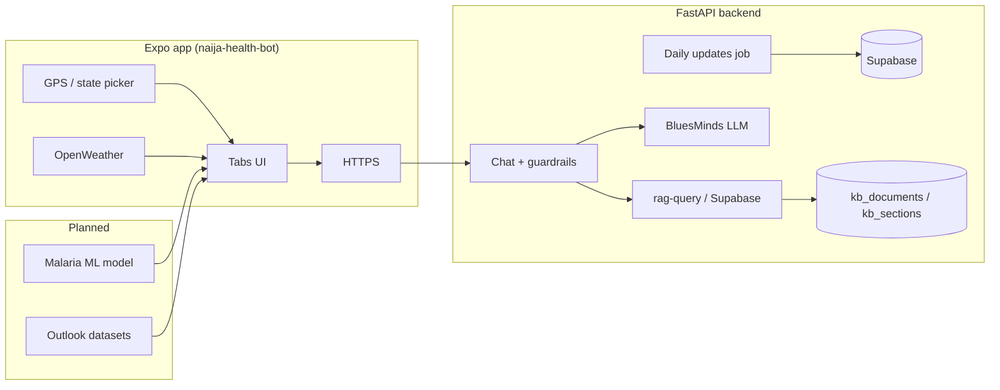

# 9ja Health

**AI-powered malaria awareness and health intelligence for Nigeria — mobile-first, source-grounded, and built for everyday use.**

9ja Health helps people understand malaria risk in context, take practical prevention steps, and get **trustworthy answers** from a curated knowledge base — without replacing doctors or guessing personal diagnoses.

---

## Why this matters

Malaria still kills more than **600,000 people per year** worldwide, mostly in sub-Saharan Africa. Nigeria carries one of the largest burdens of disease on the continent. At the same time:

- **Misinformation spreads faster than clinics can respond.** People search symptoms online, buy the wrong medicines, or delay testing.
- **Transmission follows weather and place**, but most apps either show raw forecasts or generic health articles — not a clear, local story.
- **Official guidance exists** (WHO, NMEP, NCDC) but is scattered across PDFs, portals, and news sites that few people read end-to-end.

9ja Health is aimed at that gap: **actionable, honest information** for people living in Nigeria, with strict safety boundaries and named sources — the same need that global health programmes emphasise for digital health in LMICs, applied to one high-impact disease first.

---

## The problem → our response

| Problem | What 9ja Health does |
|--------|----------------------|
| People need malaria facts they can trust, not model hallucinations | **Retrieval-augmented assistant (RAG)** over a curated knowledge base (WHO and allied sources), loaded into Supabase; answers are blocked if nothing relevant is retrieved |
| Chatbots often diagnose, dose, or wander off-topic | **Server-side guardrails**: malaria-only scope, no dosing, medicine names limited to retrieved text; off-topic and unsafe prompts refused |
| “Risk” apps imply personal predictions | **Area-level framing only** — population patterns and environment, never “you have malaria” |
| Weather affects mosquitoes but users do not see the link | **Live local weather** on Home; **Prevention** screen reserved for **ML likelihood + tips** once the model is connected |
| Health news is noisy | **Updates** screen + backend **daily scrape → AI summary → 24h report** pipeline (see `backend/api/reports.py`) |
| Secrets and keys must not live in the app | **FastAPI backend** holds LLM and Supabase service keys; the Expo app only calls `EXPO_PUBLIC_API_BASE_URL` |

---

## What you get in the app

Bottom tabs: **Home · Outlook · Prevention · Assistant · Updates** (Profile from Home).

| Screen | Purpose | Status |
|--------|---------|--------|
| **Home** | Location, live weather (incl. feels-like & cloud cover), shortcuts to outlook, prevention, updates, and the assistant | Live weather needs `EXPO_PUBLIC_OPENWEATHER_API_KEY` |
| **Outlook** | Area **trends** from datasets / models (not personal diagnosis) | UI ready; charts when data + model are wired |
| **Prevention** | **Daily AI report**: malaria likelihood from weather + model, plus tips | UI ready; model output pending |
| **Assistant** | Malaria Q&A with RAG + guardrails; optional sign-in to save chats | Live when backend + Supabase RAG are configured |
| **Updates** | One **daily health briefing** (refreshed every 24 hours) | Backend job available; app consumes `/api/v1/health-reports` when connected |

**Safety (non-negotiable):** not a diagnostic tool; emergencies → **112** in Nigeria; no prescriptions or dosing; medical copy should be reviewed before wide release.

---

## Architecture



**Knowledge base:** Markdown sections under `backend/knowledge_base/RAGInfo/documents/`, loaded with `python -m scripts.load_knowledge`. SQL and edge functions: `backend/supabase/README.md`.

**Auth (optional):** Supabase email + password + **TOTP**; saved conversations via REST. Guests can chat without an account.

---

## Repository layout

```text
naija-health-bot/          React Native + Expo Router mobile app
  src/app/                 Screens (tabs + profile / account)
  src/services/            Assistant API, weather, Supabase client
  src/components/          Shared UI, weather strip, location picker
backend/                   FastAPI service (deployed e.g. on Render)
  api/                     chat, health, conversations, health-reports, jobs
  guardrails/              Input/output safety
  services/                RAG retrieval, chat pipeline, reports pipeline
  knowledge_base/          Approved sources + RAG document corpus
  supabase/                SQL migrations + rag-embed / rag-query functions
  scripts/                 load_knowledge, run_daily_updates
prompts-and-guides/        Product, design, and engineering reference
```

The old workshop `RAG/` folder at the repo root is not part of the production app and can be removed.

---

## Quick start

### Mobile app

Requirements: Node.js compatible with **Expo SDK 58**, npm.

```sh
cd naija-health-bot
npm ci
cp .env.example .env    # if present; set keys below
npx expo start
```

| Variable | Purpose |
|----------|---------|
| `EXPO_PUBLIC_API_BASE_URL` | Backend root, e.g. `http://127.0.0.1:8000` or your Render URL |
| `EXPO_PUBLIC_OPENWEATHER_API_KEY` | Current weather on Home |
| `EXPO_PUBLIC_SUPABASE_URL` / `EXPO_PUBLIC_SUPABASE_ANON_KEY` | Optional sign-in and saved chats |

```sh
npx tsc --noEmit
npx expo lint
```

### Backend (assistant + RAG + jobs)

Requirements: **Python 3.11+** (3.14 supported in dev), virtualenv.

```sh
cd backend
python -m venv .venv
.venv\Scripts\activate          # macOS/Linux: source .venv/bin/activate
pip install -r requirements-dev.txt
cp .env.example .env            # fill BLUESMINDS_API_KEY, Supabase keys for RAG/accounts
uvicorn main:app --reload --port 8000
pytest
```

**RAG setup (one-time):** run `supabase/chat_history.sql` and `supabase/rag.sql` in the Supabase SQL editor; deploy `rag-embed` and `rag-query` from `backend/`; then:

```sh
.\.venv\Scripts\python.exe -m scripts.load_knowledge
```

Confirm: `GET /api/v1/health` → `"rag": true`, `"accounts": true` when keys are set.

**Daily updates job:** `POST /api/v1/jobs/daily-health-updates` with header `X-Job-Secret` (see `UPDATES_JOB_SECRET` in `.env.example`). List reports: `GET /api/v1/health-reports`.

Interactive API docs: `http://localhost:8000/docs`.

---

## What is implemented vs next

**Shipped in this repo**

- Production-shaped **mobile UI** (streamlined tabs, weather strip, assistant with rotating prompts)
- **FastAPI** chat with model fallbacks, rate limits, optional **Supabase auth + history**
- **RAG** corpus (~127 malaria sections), similarity search, load script with retries
- **Guardrails** (scope, medicines, dosages, urgency hints)
- **Daily health-updates** backend (scrape → summarise → store)
- **Keep-alive** for free-tier hosting

**Still to wire**

- **ML malaria likelihood** model → Prevention screen report
- **Outlook** charts from MAP / national datasets
- **Updates** tab fully bound to `health-reports` in the app
- End-to-end **scheduled cron** for daily job in production
- Clinical / content review before public health deployment

---

## Contributing and documentation

- Design tokens and IA: `prompts-and-guides/`
- Backend Supabase: `backend/supabase/README.md`
- Do **not** commit `.env` files or service-role keys
- LLM and scraping keys stay on the server only

---

## Licence and disclaimer

9ja Health provides **general health information and area-level context**. It is **not** medical advice, diagnosis, or treatment. For illness or emergency, contact a qualified professional; in Nigeria call **112** for emergencies.